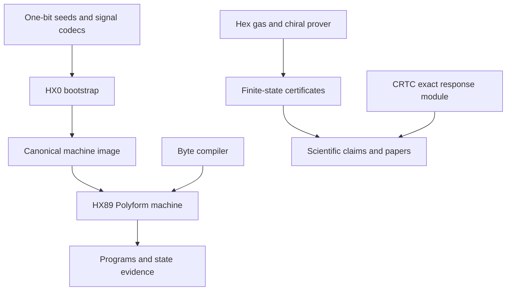
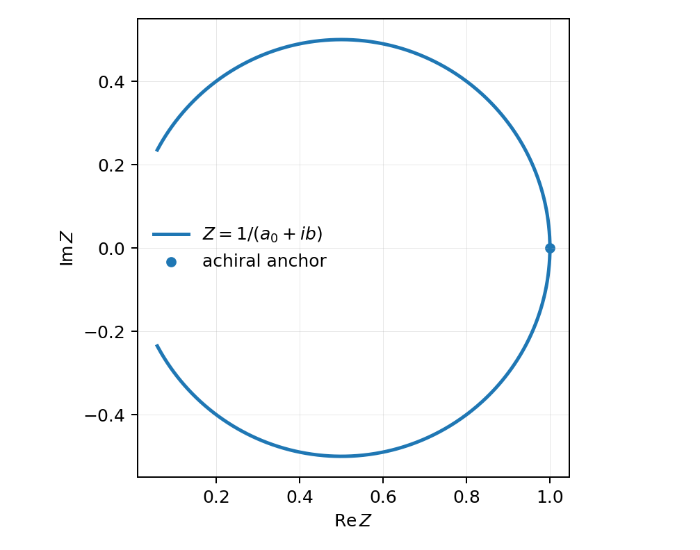
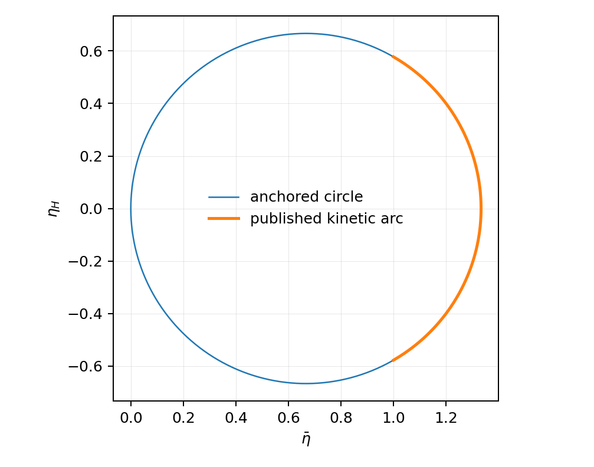
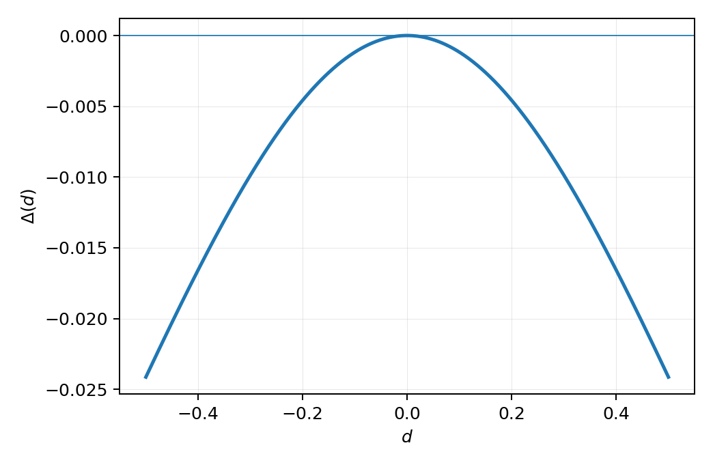

# HX89

**Hexworld Polyform Machine · deterministic hexagonal lattice gas · chiral transport research**

  

HX89 brings an executable sparse five-dimensional Polyform machine, the HX0 one-bit bootstrap, audio transport, a reversible six-channel hexagonal lattice gas, and a mathematical study of chiral response into one source tree. It includes sources, deterministic tests, generated evidence, three research PDFs, and their build inputs. These badges describe repository contents, not live CI status.

## Quick start

On **Linux x86-64** with a C compiler, GNU binutils, `make`, and Python 3:

```sh
make all
make check
./bin/hx89 polyforms/hello.anything 1 100
./bin/hx89-chiral-proof
```

`make check` covers the HX0 bootstrap, signal paths, machine behavior, byte composition, gas, chiral reciprocity, and exact transport identities. The full research and document verification additionally needs SymPy, mpmath, and LaTeX. Prebuilt Linux x86-64 executables are included in [`bin/`](bin/).

## System map



| Area | Implementation | Guide |
| --- | --- | --- |
| Sparse machine, Q², phase state, snapshots, symbolic Conway expressions | [`src/hx89_x86_64.S`](src/hx89_x86_64.S) | [Machine](docs/MACHINE.md) |
| HX0, PCM, 125-baud FSK, Bell 202 | [`boot/`](boot/), [`src/pulse_pcm.c`](src/pulse_pcm.c) | [Signal bootstrap](docs/SIGNAL_BOOTSTRAP.md) |
| Canonical byte-to-Polyform compiler | [`src/byte_polyform.c`](src/byte_polyform.c) | [Composition lemma](docs/COMPOSITION_LEMMA.md) |
| Six-channel gas and reverse rule | [`src/hex_gas.c`](src/hex_gas.c) | [Hex gas](docs/HEX_GAS.md) |
| Chiral reciprocity certificate | [`src/chiral_law.c`](src/chiral_law.c) | [Chiral reciprocity](docs/CHIRAL_RECIPROCITY.md) |
| Response geometry and counterexample | [`research/crtc/`](research/crtc/) | [CRTC](research/crtc/README.md) |

`HX87P1` and `HX87SEM3` are serialized format and semantic-image identifiers retained by the bootstrap, not separate release names.

## Results and scientific boundary

| Claim | Status | Evidence |
| --- | --- | --- |
| Local collision bijection, mass and momentum conservation | Exhaustive over 64 occupation states | [Independent oracle](tests/test_chiral_law.py), [certificate](evidence/chiral_law_certificate.txt) |
| Endpoint chiral reversing and echo laws | Local identities and complete 2 × 2 torus certificate over 16,777,216 occupations for both chiralities | [Proof source](src/chiral_law.c), [scope](docs/CHIRAL_RECIPROCITY.md) |
| Chiral FHP transport circle | Exact molecular-chaos algebra from attributed published coefficients | [Transport circle](docs/TRANSPORT_CIRCLE.md), [attribution](docs/LITERATURE_BOUNDARY.md) |
| Anchored response circle | Exact equivalence to constant `Re(1/Z)` for nonzero complex response with the stated positive real anchor | [CRTC theorem](research/crtc/docs/THEOREM.md) |
| Protection by symmetry and positive dissipation | Refuted in general by an exact stationary Ornstein–Uhlenbeck counterexample | [Counterexample](research/crtc/docs/COUNTEREXAMPLE.md) |
| Circle survival in fully correlated chiral FHP Green–Kubo dynamics | **Open**; no protecting Ward identity is established | [Scientific status](SCIENTIFIC_STATUS.md), [claims](scientific/claims.json) |

The response geometry and counterexample figures are generated from the equations in the thesis source:







Read the [scientific status ledger](SCIENTIFIC_STATUS.md) and [theorem status](docs/THEOREM_STATUS.md) before citing a result. The [claim registry](scientific/claims.json) and [equation registry](scientific/equation_registry.json) are machine-readable.

## Examples

```sh
./bin/hx89 polyforms/hello.anything 1 100
./bin/hx89 polyforms/entropy.hx 12345 100
./bin/hx89 --phase-forward polyforms/phase_torus.hx 1 20
./bin/hx89-gas 64 64 40 12345 density.pgm density.hx
```

These examples may write output in the working directory. Native execution is **off by default**; the explicit `--native` option enables host native paths for that invocation. Polyforms and snapshots are process inputs; the runtime is not a hardened OS sandbox. Read [`SECURITY.md`](SECURITY.md) and the [native bridge guide](docs/NATIVE_BRIDGE.md) before processing untrusted inputs.

## Verification

```sh
make check                           # deterministic machine and transport logic
make sanitize                        # sanitizer checks
make audit                           # regenerate and audit release evidence
make -C research/crtc verification   # research module; SymPy and mpmath
make verify-all                      # full rebuild, research and PDFs; needs LaTeX
sha256sum -c MANIFEST.sha256         # packaged snapshot before local changes
```

The committed [verification records](evidence/verification/) and [CRTC transcript](research/crtc/results/VERIFICATION.txt) describe previous runs in their stated environment, not live CI. `MANIFEST.sha256` covers this packaged snapshot and must be regenerated after editing or regenerating evidence. See [Reproducibility](REPRODUCIBILITY.md) for the full route.

## Papers and repository guide

| Document | PDF | Source |
| --- | --- | --- |
| Thesis | [Alex_Moraru_Thesis.pdf](dist/Alex_Moraru_Thesis.pdf) | [`thesis/main.tex`](thesis/main.tex) |
| Thesis companion | [Alex_Moraru_Thesis_Companion.pdf](dist/Alex_Moraru_Thesis_Companion.pdf) | [`thesis/companion.tex`](thesis/companion.tex) |
| Response rigidity paper | [CRTC_Response_Rigidity.pdf](dist/CRTC_Response_Rigidity.pdf) | [`research/crtc/paper/main.tex`](research/crtc/paper/main.tex) |

[`polyforms/`](polyforms/) holds runnable programs, [`seeds/`](seeds/) holds bootstrap images, [`tests/`](tests/) holds checks and independent oracles, [`evidence/`](evidence/) holds certificates and captured outputs, and [`tools/`](tools/) holds consistency checks. The [release summary](RELEASE.md) describes the scope.

## License

Apache License 2.0. See [`LICENSE`](LICENSE). Literature-derived formulas retain the attribution and scope in the [literature boundary](docs/LITERATURE_BOUNDARY.md).
