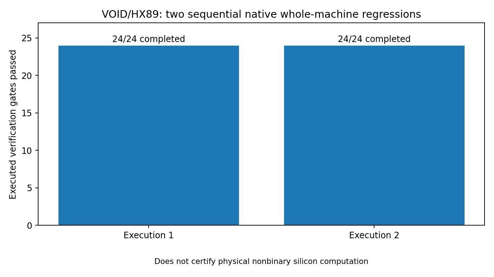
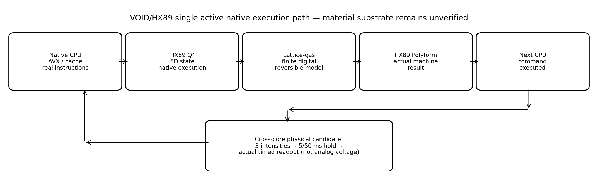
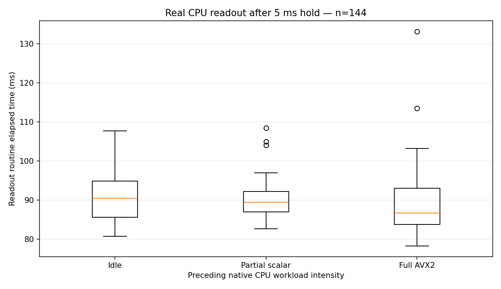
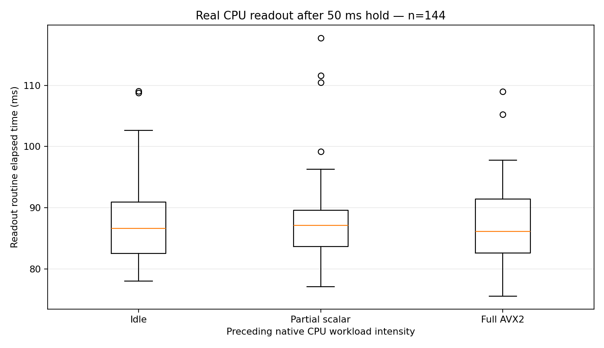

# VOID/HX89 — Final native integration and reproducible release

This is the **ONE coherent active workplace/**. Historical archives, source versions, netlists and failed tests are preserved in place under their named history/provenance. The main executable entry point is `00_CONTROL/run_canonical_release.py`, which executes the complete live HX89/CPU/AVX/reversible digital lattice/cross-core material candidate workflow sequentially.

## Fresh double acceptance (executed, not simulated)

| Run | Native gates | Failures | Full raw receipt | Elapsed (s) |
|---|---:|---:|---|---:|
| 1 | 24/24 | 0 | `04_TESTS_AND_LOGS/20261029_WHOLE_MACHINE_RESTART/WHOLE_MACHINE_ACCEPTANCE_1793297152848705731.json` | 130.959 |
| 2 | 24/24 | 0 | `04_TESTS_AND_LOGS/20261029_WHOLE_MACHINE_RESTART/WHOLE_MACHINE_ACCEPTANCE_1793297283801507383.json` | 101.044 |

- The raw acceptance file, whole-machine console log and per-stage transcripts are separately SHA-verified.
- Original user archive hashes were unchanged before and after both native runs.
- The CPU material experiment preserves each scheduler-overrun acquisition and its independent rejected CSV, stdout and stderr; it never chooses runs by the desirability of a result.
- `09_RESULTS_VISUALS/native_repeated_acceptance.png` and `.svg` are generated from these two exact native receipts. The other 5-ms/50-ms graphs are directly derived from native timing samples.

## Final physics conclusion and nonfabrication contract

Two native 24-gate regression PASS results validate the real **digital/native execution and measurement pipeline**. They do **not** validate useful on-die sub-threshold analog computing, multi-level material charge memory, raw analog readback, physically connected VOID K06 circuits or a novel physically nonbinary machine. The reversible C gas remains a digital model. No fictitious temperature/current/voltage traces exist in these results. The 116 historical milestones are source/evidence inventory, not 116 physically completed device functions.

## Canonical source hierarchy

| Directory | Role |
|---|---|
| `00_PROJECT_PORTAL/` | One active entry point, links and ownership |
| `00_CONTROL/` | 116-milestone planner, watchdog, exclusive native run coordinator |
| `01_SOURCES_VERIFIED/` | Original byte-identical supplied research archives, preserved independent history |
| `02_ACTIVE_R08/` | VOID K01–K06 netlists, circuit libraries, physical acceptance contracts |
| `03_NATIVE_TOOLCHAIN/` | HX89/EntropyAVX/native CPU batch and physical probe sources/binaries |
| `04_TESTS_AND_LOGS/` | Immutable failed/accepted raw test records and independent run receipts |
| `05_EVIDENCE/` | Actual CPU-material measurements and source provenance |
| `06_RELEASE_CONTROL/` | Current runbook, release manifest builder and auditor |
| `07_DELIVERY/` | Release and transport context |
| `08_DOCUMENTATION/` | Architecture, build, evidence, physics requirements, source selection |
| `09_RESULTS_VISUALS/` | Real-data plots (PNG/SVG) and rendering scripts |
| `90_PRESERVED_PROVENANCE/` | Earlier code snapshots and historical branching preserved |

**One executable build and test interface:**

```sh
python3 -S 00_CONTROL/repair_restored_native_build.py
python3 -S 00_CONTROL/run_canonical_release.py --repeat 2 --cycles 4 --material-blocks 2
```

**One reproducible module builder** from the restored `workplace/`:

```sh
python3 06_RELEASE_CONTROL/build_module_release.py --dest NEW_EMPTY_RELEASE_DIRECTORY
```

Use its `RESTORE_AND_AUDIT.py` plus audited JSON manifest to create and verify the exact single tree. The historical tar-splitting scripts are retained only for provenance and are **not** the authoritative nine-folder builder.

## Visualizations








