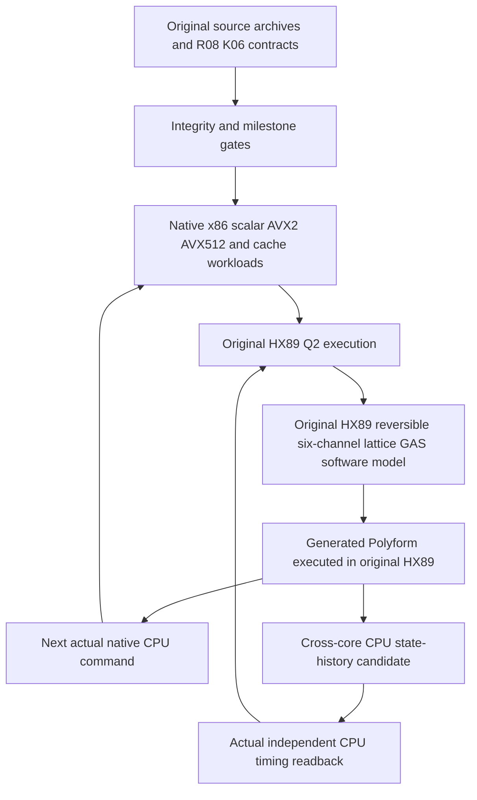

# Architecture and execution — one canonical project

## Active source order and trust boundaries

The complete machine under test consists of existing native executables coordinated through the preserved `CPU_VOID_BATCH_CYCLE` source. Its actual tested path is:

The `G` stage is an authentic **software implementation of a finite reversible lattice gas**, not real acoustic, thermodynamic, charge or gas-medium motion. `M` and `H` run real CPU instructions and record real timing; their values pass digitally into HX89. The proposed physical material processor remains **unproven**.

## Canonical execution entry points

- **Whole machine:** `00_CONTROL/run_whole_machine.py` with `--cache-causal --history-causal --material-history`
- **Repeated validation:** `00_CONTROL/run_canonical_release.py`
- **HX89:** `03_NATIVE_TOOLCHAIN/HX89/` original native source, 5D topology, Q² and Polyform runtime.
- **EntropyAVX:** `03_NATIVE_TOOLCHAIN/EntropyAVX/` derivative, repaired BVH and launcher, original input archive separately preserved.
- **CPU batch and digital-to-physical candidate:** `03_NATIVE_TOOLCHAIN/CPU_VOID_BATCH_CYCLE/cpu_batch.c`, `full_stack_cycle.py`, `cpu_cross_core_history.c`, `cross_core_material_gate.py`.
- **Circuit specification:** `02_ACTIVE_R08/02_PHYSICAL_CIRCUITS/VOID_K06_INTEGRATED_PHYSICAL_CONTINUUM.cir` and linked `.lib` files.
- **Research database and watchdog:** independent tooling, not experimental computing substrate.

## Why the CPU mechanisms matter

Each of the on-die entropy source, AVX/SIMD, L1/L2 storage, power/frequency feedback, thermal history, HX89 reversible state cycle, and K06 charge/resonance network is a possible causal ingredient. The machine cannot claim all seven are physically connected merely because their source modules exist. A physical acceptance event needs a controlled material stimulus, an actual material transformation, independent raw readback, meaningful retention or operation, negative controls and repeatability.

## What the existing machine does

1. Runs actual instructions, measures processor timings and saves traces.
2. Executes HX89's native 5D traversal, Q² programs, snapshots and reversible model.
3. Produces and executes generated Polyforms, checks raw lattice image against HX89 emission.
4. Converts actually acquired host observations into the next native CPU workload.
5. Acquires real cross-core timing readouts after three stimulus intensities and at two hold delays.
6. Independently checks schema, source/bin hashes, history linkage, schedule and negative mutations.

No step silently generates a charge/current value. The CPU materials experiment tests a possible state-memory effect but does not use a direct on-die analog current/temperature measurement.

## Physically nonbinary acceptance

**Never mark physical Gate K PASS based solely on native code, timing jitter, cache latency, RDRAND words, or Q² calculations.** All are relevant development and experimental outputs, but the final effect must be causally attributable to a reproducible, physically observed, nonbinary state and useful material operation.

See the unmodified original milestones M31, M38, M47, M52, M55, M59, M60, M78, M88, M99, M113–M115, alongside all other IDs and their original dependencies.
