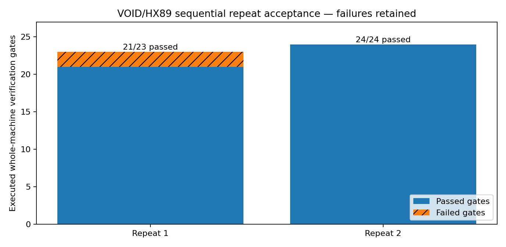

# Verified cumulative release — repeated execution and material claim boundary

## One active machine and preserved history

The active CPU/HX89 application is the source under `03_NATIVE_TOOLCHAIN/`, coordinated by `00_CONTROL/run_whole_machine.py`. The historical R01–R08 archives, full two-part research master, original HX89 research sources, K01–K06 circuit netlists, EntropyAVX source, AC/DC experiments, research cache and prior failed tests remain in their named provenance directories. Multiple historical archives are **preserved evidence**, not competing active executables.

## Final fresh, sequential whole-machine repeat

The source tree's actual `run_canonical_release.py --repeat 2 --cycles 4 --material-blocks 2` process ran to completion, producing two *new* whole-machine acceptance receipts, with fixed deterministic scheduling instructions but independently acquired non-deterministic CPU timings:

| Sequential execution | Native acceptance gates | Evidence classification | Outcome |
|---|---|---|---|
| 1 | 21/23 passed; 2 failed | `EXECUTION_FAILURE_OR_INCOMPLETE` | `04_TESTS_AND_LOGS/20261029_WHOLE_MACHINE_RESTART/WHOLE_MACHINE_ACCEPTANCE_1793296661934872142.json` |
| 2 | 24/24 passed; 0 failed | `NATIVE_FULL_STACK_PASS_PHYSICAL_GATE_UNVERIFIED` | `04_TESTS_AND_LOGS/20261029_WHOLE_MACHINE_RESTART/WHOLE_MACHINE_ACCEPTANCE_1793296859746393954.json` |

- The first execution's physical cross-core candidate exceeded its explicitly bounded stimulus duration. The candidate was refused and independent material evidence correctly failed closed. **Both failed gates and original raw logs remain included**.
- The second whole-machine run passed **24 of 24 native/software/hardware-instruction gates**. This is a fresh result, not a promoted earlier log.
- The repeat summary intentionally reports `all_native_execution_suites_passed=false` because one of two runs failed. The first failure must not be hidden by the second successful run.
- The original uploaded archive hashes were equal before and after both executions.
- No measured physical nonbinary material operator or memory cell is established by this suite; the physical Gate K is **NOT VERIFIED**.

## What the executed gates prove

Native C/assembly programs ran real CPU scalar/SIMD/cache workloads; authentic HX89 5D/Q²/Polyform paths and reversible **digital** lattice model executed; CPU cache/history and real randomized multi-intensity cross-core timing observations were saved and fed into next native CPU commands. Independent tests checked source/binary identity, output linkage, negative/corrupt traces, K01–K06 source connectivity, and preserved sources. The experiment does **not** read independent analog current/voltage, directly bias silicon transistors into weak inversion, verify three stable physical analog levels, or demonstrate an assembled K06 electrical connection.

## Evidence locations

- Full sequential run: `04_TESTS_AND_LOGS/CANONICAL_RELEASE_RUNS/canonical_1793296659196172389/`
- First failed acquisition receipt: `04_TESTS_AND_LOGS/20261029_WHOLE_MACHINE_RESTART/WHOLE_MACHINE_ACCEPTANCE_1793296661934872142.json`
- Second accepted native receipt: `04_TESTS_AND_LOGS/20261029_WHOLE_MACHINE_RESTART/WHOLE_MACHINE_ACCEPTANCE_1793296859746393954.json`
- Independent material-science readback and negative controls: `05_EVIDENCE/20261029_REAL_CPU_MATERIAL_GATE/`
- Original full historical M00–M115 ledger: `00_CONTROL/CANONICAL_IMPLEMENTATION_LEDGER.tsv`

## Release restoration acceptance

Ten logical ZIP folders (each strictly below **200,000,000 bytes**) are generated from a single frozen tree. Reconstruct the historical master ZIP from its exact original `.001` and `.002` parts, then validate every restored file's length, SHA-256, directory membership and POSIX mode. Use `RESTORE_AND_AUDIT.py` from the accompanying audit kit. Do not treat a passing ZIP test as evidence of the final physical Gate K.

## Scope of the release

**This is a professionally organized, restorable native engineering research release, not the final independently proven thermodynamic nonbinary hardware machine.** Future work must pass a calibrated physical write/hold/read, useful collective nonbinary transformation, and independent causal-material readback before claiming complete nonbinary operation.
