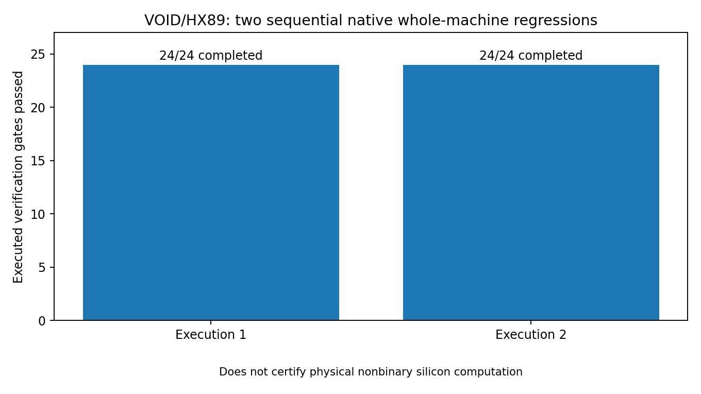
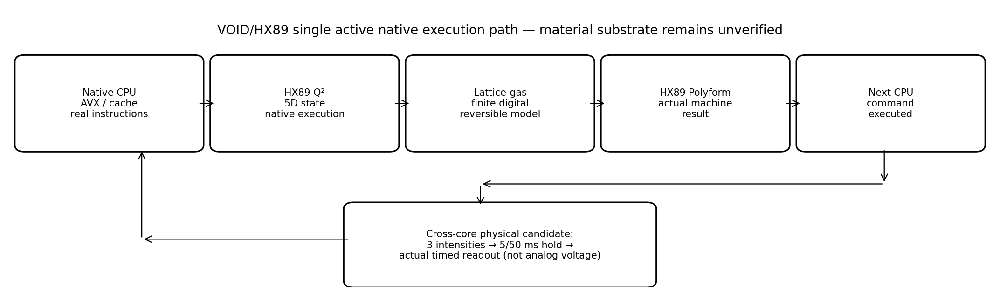
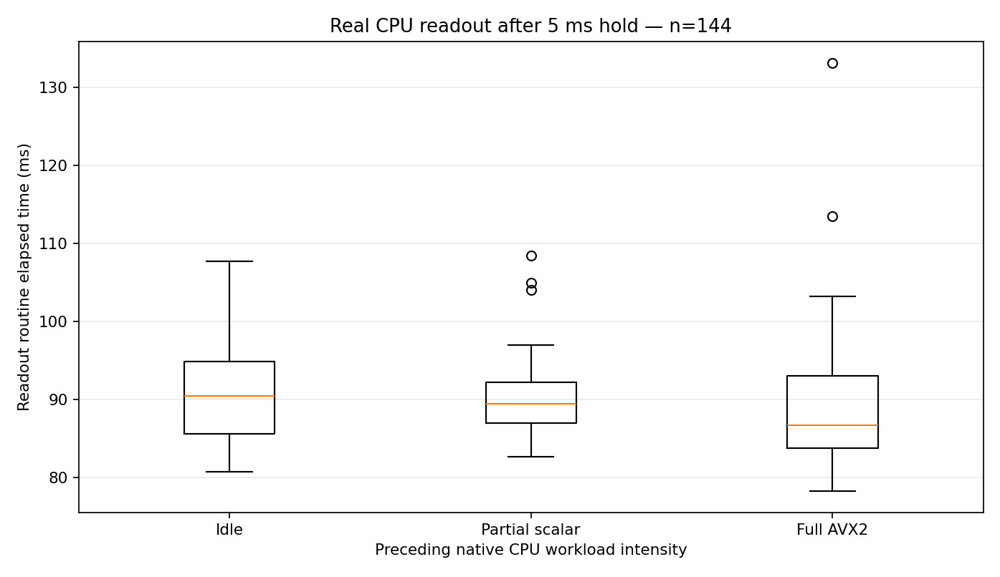
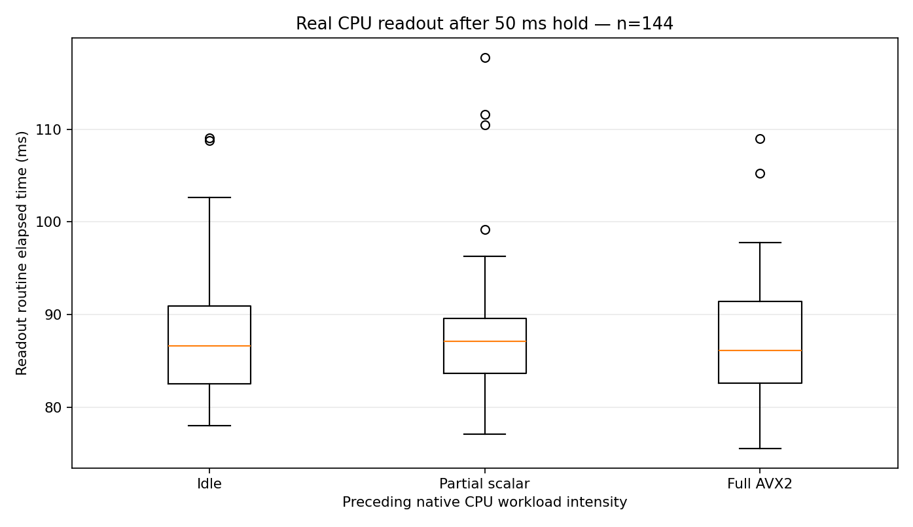

# VOID / HX89 — Canonical cumulative engineering workplace

**One active application tree, complete source history, runnable native tests, and immutable evidence.**

This is the reconstructed cumulative **VOID — Operates Independent of Digital** research workspace. It is **not** a rewritten application, and it is **not** a claim that physical nonbinary computation has already been achieved. The authoritative engineering objective is useful collective nonbinary material computation and memory on or in conjunction with conventional CPU hardware. The present executable platform implements native x86, HX89 state evolution, CPU observation/feedback, and a reversible **digital** lattice model. The physical Gate K remains separately evidence-gated.

## Open this project in order

1. [Canonical portal](00_PROJECT_PORTAL/README.md) — actual active components and trust boundaries.
2. [Machine architecture](08_DOCUMENTATION/01_ARCHITECTURE_AND_EXECUTION.md) — the causal graph and native execution cycle.
3. [Build and rerun](08_DOCUMENTATION/02_BUILD_AND_RUN.md) — one correct entry point and sequential, evidence-preserving repeats.
4. [Physical proof contract](08_DOCUMENTATION/03_VERIFICATION_AND_PHYSICAL_GATES.md) — what each verified result does and does not establish.
5. [Historical source provenance](08_DOCUMENTATION/04_SOURCE_PRECEDENCE_AND_HISTORY.md) — originals, sealed copies, source identity and version history.
6. [Complete milestone ledger](00_CONTROL/CANONICAL_IMPLEMENTATION_LEDGER.tsv) — exactly **M00–M115**, with historical fields retained.
7. [Final repeated-run evidence and release status](08_DOCUMENTATION/07_FINAL_REPEATED_EXECUTION_AND_RELEASE.md) — the exact fresh passing and failed native tests.
8. [Measured results](09_RESULTS_VISUALS/README.md) and [CPU material-gate report](05_EVIDENCE/20261029_REAL_CPU_MATERIAL_GATE/FINAL_PHYSICAL_GATE_EXECUTION_20261029.md).

## Latest 2× complete executed verification

[Final native run receipts, reproducibility and source hierarchy](06_RELEASE_CONTROL/CANONICAL_FINAL_REPEAT_AND_RELEASE_20261029.md) — **2 × 24/24 named gates passed**, raw evidence and rejected-scheduler samples retained. No physical nonbinary silicon claim is promoted.



## Canonical directory hierarchy

```text
workplace/
  README.md                         This entry point; NOT another fork
  00_PROJECT_PORTAL/               Canonical ownership and navigation
  00_CONTROL/                      Planner, bounded watchdog, one run coordinator
  01_SOURCES_VERIFIED/             Original, byte-preserved archives and source snapshots
  02_ACTIVE_R08/                   VOID K01–K06, physical netlists, evidence contracts
  03_NATIVE_TOOLCHAIN/
    HX89/                           Original native 5D/Q²/Polyform/reversible machine
    EntropyAVX/                     Repaired derivative (original archive remains intact)
    CPU_VOID_BATCH_CYCLE/           Native stimulus, cache/history, HX89 feedback
    ResearchCache/                  Independent research metadata, not VOID runtime
  04_TESTS_AND_LOGS/               Historical and new unaltered test/failure receipts
  05_EVIDENCE/                      Raw observations, research provenance, physical gate
  06_RELEASE_CONTROL/              Runbooks, original archive index, release receipts
  07_DELIVERY/                     Transport instructions, not separate machine source
  08_DOCUMENTATION/                Architecture, build, research and safety boundaries
  09_RESULTS_VISUALS/              Measurement-derived charts and architecture figures
  90_PRESERVED_PROVENANCE/         Historical continuity, intentionally not flattened
```

## Real simultaneous two-CPU experimental extension (current run)

This working tree now also contains a **real simultaneous two-input CPU factorial probe** integrated as three independently audited native machine gates. The previous 116 milestones and originals are preserved.

- Source: [`cpu_dual_physical_response.c`](03_NATIVE_TOOLCHAIN/CPU_VOID_BATCH_CYCLE/cpu_dual_physical_response.c) and [`dual_reservoir_hx89.py`](03_NATIVE_TOOLCHAIN/CPU_VOID_BATCH_CYCLE/dual_reservoir_hx89.py).
- Acquired raw data: [`20261029_DUAL_CPU_REPEATED/`](04_TESTS_AND_LOGS/20261029_DUAL_CPU_REPEATED/).
- Experimental report: [`10_DUAL_INPUT_PHYSICAL_CAUSAL_INTERVENTION.md`](08_DOCUMENTATION/10_DUAL_INPUT_PHYSICAL_CAUSAL_INTERVENTION.md), including independently measured graphs.

The actual four-condition A/B/A+B response is transported through **executed HX89 Q²** and then changes the next native CPU workload. It is a real processor intervention with digital timing readback, not a manufactured voltage or an independently confirmed material-memory operation. The paired observed nonlinear contrast was not reproducible across runs.

To execute the entire original machine and this experiment together:

```sh
python3 -S 00_CONTROL/run_whole_machine.py --cycles 4 --cache-causal --history-causal --material-history --material-blocks 2 --dual-physical --dual-blocks 16
```

To run two complete sequential acquisitions from predefined inputs, keeping every passing and failed receipt:

```sh
python3 -S 00_CONTROL/run_canonical_release.py --repeat 2 --cycles 4 --material-blocks 2 --dual-physical --dual-blocks 16
```

## Execution — run from this root

```bash
# Native dependency rebuild after extracting the ZIPs into a new directory
python3 -S 00_CONTROL/repair_restored_native_build.py

# Execute the WHOLE existing machine, including the real cross-core experiment
python3 -S 00_CONTROL/run_whole_machine.py \
  --cycles 4 --cache-causal --history-causal --material-history --material-blocks 2

# Re-run sequentially with bounded tests, unique append-only evidence and no overlapping builds
python3 -S 00_CONTROL/run_canonical_release.py --repeat 2 --cycles 4 --material-blocks 2
```

The canonical repeated runner rejects a claimed success without a newly generated and checked whole-machine acceptance receipt. It saves both successes **and failures**. A new native experiment is never populated with synthetic analog voltage, current or temperature numbers.

## Architecture visual



See the [SVG source](09_RESULTS_VISUALS/whole_machine_execution_architecture.svg) for a zoomable view.

## Measurement visualizations

| CPU observation, 5 ms hold | CPU observation, 50 ms hold |
|---|---|
|  |  |

These figures are generated from acquired CPU timing CSVs, not analog-current measurements. The preserved experimental results **do not establish** stable independent physical three-level memory.

## Data status and research honesty

| Executed native platform | Final material computer |
|---|---|
| Actual x86 workload, vector instructions, HX89 5D/Q², reversible lattice **software model**, Polyform execution, cache/cross-core timing, subsequent CPU command feedback | Directly measured and useful analog/nonbinary state, collective physical memory, independent K06-to-CPU material link, silicon sub-threshold operator, complete physical nonbinary machine **not verified** |

Original uploaded archives and all historical M00–M115 fields are immutable. Explicit contradictions and failed measurements must remain available to external auditors. Only source-backed physical measurements can promote a material milestone.

## Restore the download parts

The separately delivered folder ZIPs **recreate this one tree**, rather than distributing independently divergent versions. From the release directory use:

```bash
python3 RESTORE_AND_AUDIT.py --verify-only
python3 RESTORE_AND_AUDIT.py --dest VOID_HX89_RESTORED
```

A historical master larger than 200 MB is reconstructed byte-exact from the two original uploaded split volumes. Archive and directory names are intentionally retained for provenance. Check the final release manifest for file counts, part hashes and exact archive sizes.


## Final accepted sequential repetition

**Two fresh sequential whole-machine runs passed 24/24 named native gates each**, with zero named gate failures in these accepted runs. All original source archive hashes remained unchanged. The source of the claim is `04_TESTS_AND_LOGS/CANONICAL_RELEASE_RUNS/canonical_1793297149910189732/REPEATED_MACHINE_RESULT.json`. The raw physical material/nonbinary gate remains **NOT VERIFIED**, as described in `08_DOCUMENTATION/07_FINAL_SEQUENTIAL_RERUN_AND_ONE_TREE_RELEASE.md`. The 10 separately downloadable ZIPs restore this one project tree; their SHA-256 audit is in the delivery kit.


## Current native two-input machine evidence (latest)

The active release runner now accepts `--dual-physical --dual-blocks 16` to execute a simultaneous A/B factorial workload inside the original HX89/Q²/5D/reversible-gas/cache/history integration. The physically observed signal is **CPU time**, not an ADC or die-temperature sensor. Source identity, randomized four-condition order, actual worker overlap, HX89 state, and the next real CPU command are verified independently. Its seven pre-existing gates plus three new dual gates are executed in the combined suite.

- [Dual-input experimental protocol and real results](08_DOCUMENTATION/10_DUAL_INPUT_PHYSICAL_CAUSAL_INTERVENTION.md)
- [Full canonical dual-input acceptance](08_DOCUMENTATION/11_CANONICAL_DUAL_INPUT_RELEASE_STATUS.md)
- [Repeated 27/27 acceptance graph](09_RESULTS_VISUALS/native_27_gate_dual_repeated_execution.png)
- [Two-input physical-response graph](09_RESULTS_VISUALS/real_dual_cpu_interaction_reproducibility.png)

Run one bounded, real, deterministic-instruction test sequence (measurements are not forced to deterministic numerical values):

```sh
python3 -S 00_CONTROL/repair_restored_native_build.py
python3 -S 00_CONTROL/run_canonical_release.py --repeat 2 --cycles 4 --material-blocks 2 --dual-physical --dual-blocks 16
```

Results remain ordinary native processor-timing outcomes. The physical analog/nonbinary substrate and K06 board operation **have not** been demonstrated; pass/fail cannot be changed by an assistant's expectation.
