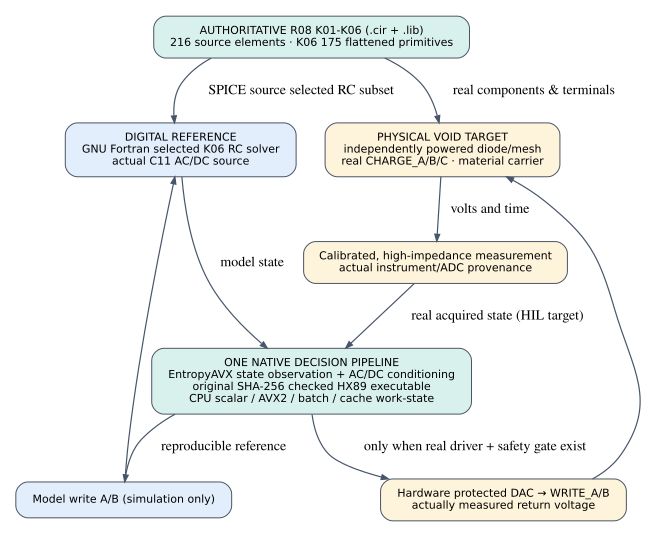
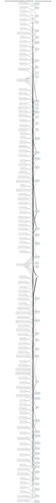
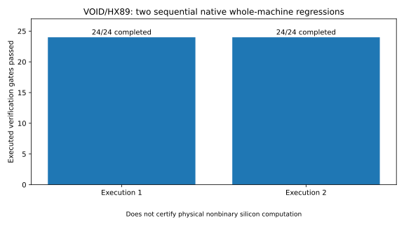

# VOID

**Nonbinary Physical Computing · HX89 Native Execution · Material\-State Research**


VOID is an experimental computing architecture investigating **continuous physical states as computational variables**, with a reproducible native software path for control, analysis, and verification\. The research combines the R08 analog circuit family, a material\-contact network, HX89 execution, AC/DC network mathematics, EntropyAVX geometry, and native CPU feedback\.

The goal is **one inspectable experiment across software and hardware**, not separate projects with unrelated demonstrations\.

## Architecture



**Digital reference path:** source\-selected K06 circuit\-state calculation → AC/DC conditioning → native HX89 decisions → EntropyAVX and CPU\-batch work → feedback into subsequent modeled states\.

**Physical target path:** powered K06/material circuit → high\-impedance observation → calibrated acquisition → the same native decision path → protected electrode stimulus → new measured material state\.

The native digital loop is executable and tested\. The physical path has source\-linked circuit captures, connector drawings, loading calculations, and an acquisition contract; **an assembled, instrumented hardware\-in\-the\-loop prototype is not claimed in this release**\.

## At a glance

|Engineering area             |Included in this release                                                                       |
|:----------------------------|:----------------------------------------------------------------------------------------------|
|**Circuit source**           |9 active R08 `.cir` / `.lib` files, with preserved R06 history                                 |
|**Electrical documentation** |9 editable KiCad source captures; 4 surrounding-board interconnect sheets                      |
|**K06 topology**             |175 expanded primitives, 74 nets; source-indexed BOM and pin maps                              |
|**Native controller**        |HX89 executable integration, AC/DC solver, EntropyAVX, CPU batch and scalar/AVX2 execution     |
|**Physical prototype design**|Power, high-impedance measurement, stimulus connections, 2×4 material carrier, calibration plan|
|**Provenance**               |Original inputs, historical passing/failing evidence, manifests, watchdog records              |

### Verification snapshot

|Acceptance suite                       |Recorded result |
|:--------------------------------------|---------------:|
|Unified native controller              |**72 / 72 PASS**|
|Preserved legacy integration           |**36 / 36 PASS**|
|Physical-source and interface preflight|**33 / 33 PASS**|

These are **software and source/connection verification results** from the November 2026 release checks\. They do not substitute for measured board behavior, a fabrication qualification, or external laboratory replication\.

[Unified acceptance results](07_FRESH_TEST_EVIDENCE/UNIFIED_CANONICAL_ACCEPTANCE_20261102/RESULTS.json) · [Physical build and acceptance documentation](09_PHYSICAL_PROTOTYPE_AND_GATEWAY/01_SYSTEM_DESIGN/README_FIRST_PHYSICAL_DIGITAL.md) · [Evidence register](09_PHYSICAL_PROTOTYPE_AND_GATEWAY/01_SYSTEM_DESIGN/SEVEN_LAYER_RELEASE_EVIDENCE_REGISTER.md)

## The circuits, in the source’s own geometry

The project includes vector drawings derived from actual electrical source files, rather than illustrative circuit images\. Open the complete views when you want to inspect components and net relationships\.

<details>
<summary><strong>View the integrated K06 circuit connectivity</strong></summary>



[Editable K06 KiCad source capture](01_PHYSICAL_CORE/08_EDITABLE_SOURCE_SCHEMATICS/VOID_K06_INTEGRATED_PHYSICAL_CONTINUUM.kicad_sch) · [Authoritative K06 SPICE source](01_PHYSICAL_CORE/01_R08_ACTIVE_SPICE/VOID_K06_INTEGRATED_PHYSICAL_CONTINUUM.cir)

</details>

<details>
<summary><strong>View native acceptance history</strong></summary>



*Historical run visualization; the fresh unified acceptance result is linked above\.*

</details>

## From circuit source to inexpensive hardware

The prototype design is deliberately modular\. It separates **&#40;1&#41; safe power and core bias**, **&#40;2&#41; high\-impedance probes**, **&#40;3&#41; bounded WRITE/BOUNDARY stimulus**, and **&#40;4&#41; the eight\-contact 2×4 material carrier**\. This keeps the material experiment replaceable without changing the HX89/CPU software architecture\.

|Prototype interface          |Editable drawing                                                                                                |Vector view                                                                                             |
|:----------------------------|:---------------------------------------------------------------------------------------------------------------|:-------------------------------------------------------------------------------------------------------|
|P1 — Power and core bias     |[KiCad](09_PHYSICAL_PROTOTYPE_AND_GATEWAY/04_VERIFIED_BOARD_INTERCONNECT/P1_BENCH_POWER_AND_K05_BIAS.kicad_sch) |[SVG](09_PHYSICAL_PROTOTYPE_AND_GATEWAY/04_VERIFIED_BOARD_INTERCONNECT/P1_BENCH_POWER_AND_K05_BIAS.svg) |
|P2 — Observation and test    |[KiCad](09_PHYSICAL_PROTOTYPE_AND_GATEWAY/04_VERIFIED_BOARD_INTERCONNECT/P2_MEASUREMENT_AND_CORE_TEST.kicad_sch)|[SVG](09_PHYSICAL_PROTOTYPE_AND_GATEWAY/04_VERIFIED_BOARD_INTERCONNECT/P2_MEASUREMENT_AND_CORE_TEST.svg)|
|P3 — Protected stimulus ports|[KiCad](09_PHYSICAL_PROTOTYPE_AND_GATEWAY/04_VERIFIED_BOARD_INTERCONNECT/P3_PROTECTED_STIMULUS_PORTS.kicad_sch) |[SVG](09_PHYSICAL_PROTOTYPE_AND_GATEWAY/04_VERIFIED_BOARD_INTERCONNECT/P3_PROTECTED_STIMULUS_PORTS.svg) |
|P4 — 2×4 material and axes   |[KiCad](09_PHYSICAL_PROTOTYPE_AND_GATEWAY/04_VERIFIED_BOARD_INTERCONNECT/P4_2x4_MATERIAL_AND_AXES.kicad_sch)    |[SVG](09_PHYSICAL_PROTOTYPE_AND_GATEWAY/04_VERIFIED_BOARD_INTERCONNECT/P4_2x4_MATERIAL_AND_AXES.svg)    |

The four peripheral sheets preserve **15 connector definitions and 78 source\-mapped pins**\. They are verified interconnect designs, **not** completed active analog\-front\-end circuits or fabrication\-ready PCB layouts\. Follow the [electrical scope and build notes](09_PHYSICAL_PROTOTYPE_AND_GATEWAY/04_VERIFIED_BOARD_INTERCONNECT/README_BUILD_AND_ELECTRICAL_SCOPE.md) before connecting equipment; probe loading is part of the experiment\.

## Reproduce the digital checks

The canonical native validation targets **Linux x86\-64** and requires the documented GNU build dependencies\. The included Linux HX89 executable is not an Apple Silicon binary; macOS can still browse the sources, documentation, and KiCad files\.

From the repository root:

```bash
python3 00_CONTROL/run_canonical_unified_acceptance.py
python3 00_CONTROL/run_integrated_validation.py
python3 00_CONTROL/run_physical_preflight.py
```

Each suite is tracked independently\. For the actual experiment and negative\-case criteria, see the [hardware\-in\-the\-loop timing and fault contract](09_PHYSICAL_PROTOTYPE_AND_GATEWAY/01_SYSTEM_DESIGN/PHYSICAL_HIL_EPOCH_AND_FAULT_CONTRACT.md)\.

## Navigate the repository

|Area                                                    |Directory                                                                              |
|:-------------------------------------------------------|:--------------------------------------------------------------------------------------|
|Circuit definitions and electrical graphics             |[`01_PHYSICAL_CORE/`](01_PHYSICAL_CORE/)                                               |
|AC/DC mathematics                                       |[`02_ANALOG_MATH/`](02_ANALOG_MATH/)                                                   |
|CPU batch, AVX and geometry research                    |[`03_CPU_NATIVE/`](03_CPU_NATIVE/)                                                     |
|HX89 engine and verification                            |[`04_HX89/`](04_HX89/)                                                                 |
|Unified execution and bridge                            |[`05_HX89_K06_BRIDGE/`](05_HX89_K06_BRIDGE/)                                           |
|Engineering validators                                  |[`06_ENGINEERING_VALIDATORS/`](06_ENGINEERING_VALIDATORS/)                             |
|Recent test evidence                                    |[`07_FRESH_TEST_EVIDENCE/`](07_FRESH_TEST_EVIDENCE/)                                   |
|Historical tests and watchdogs                          |[`08_HISTORICAL_TESTS_AND_WATCHDOG/`](08_HISTORICAL_TESTS_AND_WATCHDOG/)               |
|Physical prototype and gateway                          |[`09_PHYSICAL_PROTOTYPE_AND_GATEWAY/`](09_PHYSICAL_PROTOTYPE_AND_GATEWAY/)             |
|Version provenance and preserved original input archives|[`90_HISTORY/`](90_HISTORY/) · [`91_EXACT_UPLOADED_INPUTS/`](91_EXACT_UPLOADED_INPUTS/)|

`90` and `91` are intentional archival sections, not missing execution stages\. See [release details](README_RELEASE_20261102.md) for the complete source and evidence boundaries\.

---

**Research principle:** preserve what was executed, distinguish what was modeled from what was measured, and make every result traceable to source, parameters, and tests\.

**Licensing:** consult the original source notices and dependencies before redistribution or reuse\. A project\-wide license is not asserted by this README\.
